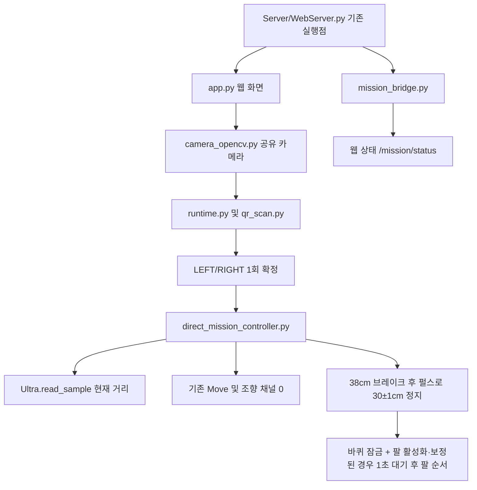

# PiCar-Pro V2 통합 프로젝트

제조사 코드 전체와 QR·주행·팔 모듈을 포함합니다. **실행 파일은 기존 `Server/WebServer.py`입니다. 새 main.py는 없습니다.**

기본 동작은 **LEFT/RIGHT QR 1회 인식 → 조향 정렬 → 배터리 보정된 느린 속도로 직진(자이로 방향 유지) → 38cm에서 브레이크 → 펄스로 조금씩 움직여 30cm ±1cm에 정지**입니다. 방향은 처음 인식한 값으로 유지합니다. 기본 팔 동작은 꺼져 있습니다.

## 자주 바꾸는 설정 4개

루트의 `mission_config.json` 맨 위에 모여 있습니다. 바꾼 뒤 서버를 재시작합니다.

| 항목 | 기본값 | 의미 |
|---|---|---|
| `target_distance_cm` | 30.0 | 정지 목표 거리. 이 값 ± `stop_tolerance_cm`(1cm) 안에서 멈춥니다 |
| `cruise_motor_volts` | 2.8 | 느린 주행 시 모터 전압(V) |
| `pulse_motor_volts` | 3.0 | 펄스 세기(V) |
| `pulse_seconds` | 0.15 | 첫 펄스 길이(초). 이후 실제 이동량을 보고 자동 조절 |

전압은 출발할 때 읽은 배터리 전압으로 PWM으로 바꿉니다(`PWM % = 모터 전압 / 배터리 전압 × 100`). 예: 2.8V는 배터리 8.4V에서 PWM 33.3, 7.0V에서 40. 배터리 값을 아직 못 읽었으면 `battery_fallback_volts`(7.4V)로 계산하고 `battery_fallback` 로그를 남깁니다. `_`로 시작하는 키는 설명용 메모이며 무시됩니다.

## 현재 실행 흐름

```text
WAIT_QR → STEER_PRELOAD(0.2초) → STEER_SETTLE(0.3초) → DRIVING ─38cm 이하─▶ PULSE_SETTLE ⇄ PULSING
                                                                              └─ 30±1cm ─▶ STOPPED_WAIT 또는 ARM_WAIT
```

- 같은 QR의 연속 프레임이나 추가 확인 시간을 요구하지 않습니다. LEFT/RIGHT 동시 인식, 같은 출발 QR 여러 개, PICK/PLACE만 보이는 경우에는 출발하지 않습니다.
- QR 확정 시 배터리 전압을 한 번 읽어 주행·펄스 PWM을 정합니다. 주행 중 전압이 출렁여도 PWM은 바꾸지 않습니다.
- QR 확정 후 조향을 오른쪽 10도로 보냈다가 가운데로 돌아오고, 0.3초 기다린 뒤 출발합니다. 조향 연결부 유격이 매번 같은 쪽으로 정리되고, 서보가 도착하기 전에 출발하지 않습니다. `direct_steer_preload_deg=0`이면 바로 가운데로 맞추고 기다립니다.
- 그다음 정상 초음파 값 하나가 `pulse_zone_cm`(38cm)보다 크면 바로 전진 명령을 냅니다.
- 주행 중에는 MPU6050 자이로(z축)로 출발 순간의 방향을 기준으로 삼고, 틀어진 각도 × `heading_gain`만큼 반대로 조향합니다(최대 ±12도, 1도 미만은 무시). 왼쪽으로 틀어지면 오른쪽(제조사 기준 양수)으로 꺾습니다. 자이로가 없거나 값이 끊기면 조향을 가운데에 두고 그대로 주행합니다.
- 초음파 값이 38cm 이하이면 바퀴를 멈추고 조향을 가운데로 돌린 뒤 `PULSE_SETTLE`로 갑니다. 이미 38cm 이내에서 출발해도 전진 주행 없이 이 단계부터 시작합니다.
- `PULSE_SETTLE`: 0.3초 기다려 차가 완전히 선 뒤, 그 이후의 새 초음파 값 5개 중앙값을 거리로 씁니다.
  - 30 ±1cm 안이면 정지선 도달로 고정합니다.
  - 멀면 전진 펄스, 가까우면 후진 펄스를 `PULSING`으로 한 번 보내고 끝나면 브레이크 후 다시 `PULSE_SETTLE`로 돌아옵니다.
- 펄스 길이 자동 조절: 첫 펄스는 `pulse_seconds`입니다. 펄스로 0.3cm 이상 움직이면 그 이동 속도로 남은 거리에 맞는 길이를 계산하고, 덜 움직이면 다음 펄스를 1.3배로 늘립니다. 항상 `pulse_min_seconds`~`pulse_max_seconds`(0.08~0.4초) 안입니다. 펄스는 제어 주기와 별개로 정해진 시간에 끊습니다.
- 펄스가 `max_pulses`(15회)를 넘거나, 정지 후 3초 안에 새 거리값 5개를 못 받으면 바퀴를 멈춘 채 `ERROR`로 종료합니다.
- 정지선 도달 전 주행 중에 거리값이 누락되거나 잘못되면 즉시 바퀴를 멈추고 `WAIT_DISTANCE`에서 최대 3초 동안 다시 읽습니다. 끝내 회복되지 않으면 `ERROR`로 종료합니다. 전체 시간 한도는 40초입니다.
- QR 방향이 확정되면 카메라 영상 중단은 주행을 취소하지 않습니다. 초음파로 정지합니다.

`approach_complete=true`는 차가 멈춘 상태에서 잰 중앙값이 30 ±1cm였다는 뜻입니다. 이때 `target_stop_latched=true`, `final_distance_cm`에 그 거리가 기록되고, 이후 바퀴 전진·후진·조향 명령을 잠급니다. 새 QR이나 거리값으로 잠금을 풀거나 다시 출발하지 않습니다.

팔을 명시적으로 활성화하고 자세 보정까지 확인한 경우에는 `ARM_WAIT`에서 기본 1초를 기다린 뒤 `ARM_TRANSFER`로 넘어갑니다. 팔이 초음파를 가릴 수 있으므로 정지선 고정 후에는 초음파를 다시 읽지 않습니다. 팔 동작 중과 완료 뒤에도 바퀴 잠금은 유지합니다. 대기 시간 1초는 임시값이며 실제 정착 시간에 맞춰 조정합니다.

## 모듈 연결



`mission_controller.py`에는 공통 작업·중지 처리와 기존 정밀 접근 코드가 보관돼 있습니다. 기본 주행은 `DirectMissionController`를 사용하며 이전 정밀 접근 조건을 만들거나 호출하지 않습니다. 팔 모듈은 정지 명령 후 설정한 대기 시간을 거쳐 채널 1~4를 사용하고 조향 채널 0을 사용하지 않습니다.

## 라즈베리파이에서 실행

제조사 setup.py로 설치된 Python·I2C·SPI 환경과 동작 확인된 카메라를 전제로 합니다. 카메라 첫 화면은 최대 15초, 시작 후 다음 화면은 최대 5초 기다립니다. 처음 받을 때는 다음과 같이 실행합니다.

```bash
git clone https://github.com/goldpiggg/picar.git
cd picar
sudo systemctl stop Adeept_Robot.service
sudo python3 Server/WebServer.py
```

이미 `~/picar`가 있다면 실행 중인 서버를 Ctrl+C로 종료하고 업데이트합니다.

```bash
cd ~/picar
git pull --ff-only
sudo python3 Server/WebServer.py
```

로컬 파일을 수정해 pull이 중단되면 변경 내용을 보존하고 충돌 원인을 확인합니다. 강제 덮어쓰기는 하지 않습니다. 실행 시 기존 제조사 서보 초기화가 이뤄지고, QR을 읽으면 주행합니다.

브라우저는 실제 라즈베리파이 IP로 접속합니다.

- `http://로봇IP:5000/`: 기본 웹 화면
- `http://로봇IP:5000/mission`: 영상·상태·전체 동작 중지
- `http://로봇IP:5000/mission/status`: 상태 JSON

웹 화면·영상은 5000번, 기존 조종 통신은 8888번 포트를 사용합니다. 노트북 localhost에서 SSH 포트 전달로 보는 경우 두 포트의 전달 여부를 확인합니다. 기본 자동 모드에서는 수동 조종을 차단합니다. QR 대기 중 화살표를 놓는 동작만으로 미션을 취소하지 않지만, QR 확정 후 정지 명령은 취소합니다. `/mission`의 전체 동작 중지는 대기 중에도 미션을 취소합니다. 오류·취소·완료 뒤에는 서버를 재시작해야 다시 출발합니다.

## 움직임 명령 확인

정상 출발 시 터미널에 아래 형태의 로그가 나옵니다.

```json
{"event":"drive_command","action":"forward","pwm":33.3,"distance_cm":80.0}
{"event":"pulse_command","action":"forward","pwm":35.7,"seconds":0.15,"distance_cm":33.2}
{"event":"pulse_result","moved_cm":1.4,"seconds":0.15,"distance_cm":31.8}
```

38cm에서 `action=stop`, `reason=PULSE_ZONE` 로그가 나오고, 이후 펄스마다 `pulse_command`·`pulse_result` 로그가 나옵니다. 상태 JSON의 `battery_volts`·`battery_source`·`cruise_pwm`·`pulse_pwm`·`pulse_count`·`last_pulse_seconds`·`pulse_cm_per_second`로 보정 동작을 확인합니다. 전진 로그는 모터 API에 명령을 보냈다는 뜻이며 실제 바퀴 회전을 감지한 결과는 아닙니다. 해당 로그가 있는데 바퀴가 안 돌면 출력·전원·모터 연결을 확인합니다. `ERROR`라면 `error` 항목에 이유가 있습니다.

## 설정

설정은 루트 `mission_config.json`에서 읽으며 변경 후 서버를 재시작합니다.

| 항목 | 기본값 | 의미 |
|---|---|---|
| `required_frames` / `hold_seconds` | 1 / 0.0 | QR 1회 인식, 추가 대기 없음 |
| `target_distance_cm` / `stop_tolerance_cm` | 30.0 / 1.0 | 정지 목표와 허용 오차 |
| `cruise_motor_volts` / `pulse_motor_volts` / `pulse_seconds` | 2.8 / 3.0 / 0.15 | 위 "자주 바꾸는 설정" 참고 |
| `pulse_zone_cm` | 38.0 | 주행을 멈추고 펄스 단계로 넘어가는 거리 |
| `pulse_settle_seconds` / `pulse_samples` | 0.3 / 5 | 펄스 후 측정 전 대기, 중앙값에 쓰는 새 측정값 수 |
| `pulse_min_seconds` / `pulse_max_seconds` | 0.08 / 0.4 | 자동 조절되는 펄스 길이의 한도 |
| `max_pulses` | 15 | 최대 펄스 횟수 |
| `battery_fallback_volts` | 7.4 | 배터리 전압을 못 읽었을 때 쓸 값 |
| `distance_offset_cm` | 0.0 | 초음파 거리 보정 |
| `direct_distance_max_age_seconds` | 0.5 | 사용 가능한 현재 거리값의 최대 나이 |
| `direct_distance_retry_seconds` | 3.0 | 측정 실패 때 멈춘 채 재측정하는 시간(주행 중, 펄스 후 측정 모두) |
| `arm_start_delay_seconds` | 1.0 | 바퀴 잠금 후 팔을 시작하기 전 대기, 임시값 |
| `approach_timeout_seconds` | 40.0 | 주행 시간 한도 |
| `auto_approach_enabled` | true | 자동 주행 사용 |
| `arm_enabled` | false | 보정 완료된 팔 순서 사용 여부 |
| `direct_steer_preload_deg` / `_seconds` | 10.0 / 0.2 | 출발 전 가운데로 돌아오기 전에 먼저 보낼 조향각(양수=오른쪽)과 머무는 시간 |
| `direct_steer_settle_seconds` | 0.3 | 가운데 정렬 후 출발까지 대기 |
| `heading_correction_enabled` | true | 자이로 방향 유지 사용 |
| `heading_gain` | 1.5 | 방향 오차 1도당 조향 각도 |
| `heading_max_steer_deg` / `heading_deadband_deg` | 12.0 / 1.0 | 보정 조향 한도, 무시할 작은 오차 |
| `gyro_z_sign` | 1 | 자이로 장착 방향. 아래 확인 결과 반대면 -1 |
| `gyro_max_age_seconds` / `gyro_calibration_seconds` | 0.2 / 1.5 | 사용할 자이로 값의 최대 나이, 서버 시작 직후 정지 상태 편차 측정 시간 |
| `camera_backend` / `camera_source` | usb / 0 | 공유 카메라 종류와 장치 |
| `max_frame_age_seconds` | 1.5 | QR 디코더의 프레임 나이 한도 |

**자이로 방향 확인(처음 한 번)**: 서버 시작 후 1.5초 동안은 로봇을 움직이지 마세요(자이로 편차 측정). 그다음 `/mission/status`의 `gyro.yaw_deg`를 보면서 로봇을 손으로 왼쪽(반시계)으로 돌렸을 때 값이 **커지면** 정상입니다. 작아지면 `gyro_z_sign=-1`로 바꿉니다. 실제 주행에서는 상태 JSON의 `heading_status`(ACTIVE·GYRO_UNAVAILABLE·OFF), `heading_error_deg`, `steer_deg`와 터미널의 `steer_command` 로그로 보정 동작을 확인합니다. 지그재그로 흔들리면 `heading_gain`을 낮추고, 여전히 휘면 올립니다.

설정 파일은 현재 사용하는 항목만 남겼습니다. 예전 파일에 있던 `direct_speed`·감속·정지 안정 설정은 읽을 수 있지만 현재 직접 주행에서 사용하지 않습니다. 팔이 꺼져 있으면 팔 자세 파일도 불러오지 않습니다. 수동 각도 확인은 팔 설정과 별개로 계속 사용할 수 있습니다.

카메라는 한 번 열어 QR과 웹 영상이 공유합니다. 초음파는 gpiozero의 실제 echo 획득 시각을 기록합니다. gpiozero 2.x의 `_read()` 인터페이스를 전제로 합니다. 최신 시각으로 같은 잘못된 거리만 반환하는 센서 고장은 단일 초음파만으로 확실히 구분할 수 없습니다.

## 팔 보정과 서비스 등록

팔 각도는 모두 임시 예시이며 `arm_enabled=false`, `calibration_confirmed=false` 상태입니다. [보정 안내](docs/ARM_CALIBRATION.md)에 관절 이름·임시값·측정 순서가 있습니다. 수동 보정 시에는 자동 접근과 팔 동작을 끄고 서버를 재시작합니다. 고정 자세 방식이며 물체 추적이나 실제 집기 성공 감지는 구현하지 않았습니다.

팔 계획만 확인하는 명령은 모터·서보를 제어하지 않습니다.

```bash
python3 -m picar_mission.arm_sequence --plan LEFT
```

부팅 시 이 체크아웃을 실행하려면 기존 서버 종료 후 선택적으로 등록합니다.

```bash
sudo python3 scripts/register_service.py --start
```

기존 Adeept_Robot.service를 백업하고 이 폴더의 Server/WebServer.py를 가리키도록 변경합니다. 다운로드만으로 별도 설치된 원래 서비스가 교체되지는 않습니다. 제조사 setup.py는 패키지 설치·네트워크 설정·재부팅을 포함하므로 기존 환경에서 매번 실행하지 않습니다.

## 팔 시연 데이터 기록

팔을 수동 조작하며 학습용 CSV를 모읍니다. 기록기(`picar_mission/recorder.py`)는 값을 읽기만 하고 모터·서보를 제어하지 않습니다. 서보 값은 마지막 **명령각**이며 실제 관절 위치가 아닙니다.

1. 로봇을 실제 정지 위치에 둡니다. 자동 주행으로 정지시킨 뒤 Ctrl+C로 서버를 끄면 차체는 그 자리에 남습니다.
2. `mission_config.json`에서 `auto_approach_enabled=false`로 바꾸고 서버를 다시 실행합니다. 자동 모드에서는 수동 조작이 막힙니다.
3. 브라우저 탭 두 개를 엽니다. `http://로봇IP:5000/`에서 ARM 버튼으로 조작하고, `http://로봇IP:5000/record`에서 기록합니다.
4. 기록 시작 → 단계마다 자세를 맞추고 마크(observe·above·grasp·close·open·lift·carry·retreat) → 기록 종료(성공 여부, 자로 잰 정지 거리)를 반복합니다.

결과는 `data/demos/`에 쌓이며 git에는 올라가지 않습니다(`.gitignore`).

| 파일 | 한 줄 단위 | 주요 열 |
|---|---|---|
| `keyframes.csv` | 마크 1번 | side, task, label, ok, base/shoulder/elbow/gripper, distance_cm, PICK·PLACE QR 중심/크기(화면 폭 기준 정규화), frame_file |
| `trajectory.csv` | 20Hz 샘플 | t, 관절 4개 명령각, distance_cm, 누르고 있는 ARM 버튼 |
| `episodes.csv` | 에피소드 1번 | side, success, stop_distance_cm(실측), sensor_distance_cm, 메모 |
| `frames/<episode>/` | 마크 1번 | 마크 순간의 카메라 사진 |

열 구성이 다른 기존 CSV가 있으면 섞이지 않도록 기록 시작을 거부합니다. PC로 가져올 때는 다음과 같이 복사합니다.

```bash
scp -r phc_20@로봇IP:~/picar/data/demos ./demos
```

## 검증 및 출처

```bash
python3 -m unittest discover -s picar_mission -p 'test_*.py' -v
python3 -m unittest discover -s tests -p 'test_*.py' -v
```

현재 직접 주행 테스트는 원본 QR 프레임 1장으로 출발, 첫 거리 하나로 전진, 배터리 전압별 PWM 계산, 38cm 브레이크, 정착 후 중앙값 측정, 전진·후진 펄스와 길이 자동 조절, 펄스 횟수 한도, 30 ±1cm 정지·바퀴 잠금, 센서 일시 실패 시 정지·회복, 영구 실패 종료, 거리 재검사 없는 팔 연결, 잠금 이후 전진·조향 차단, 제조사 Move.py의 PWM 쓰기 경로를 가상 드라이버로 확인합니다. 카메라 초기화 대기와 사용하지 않는 설정의 독립성도 검사합니다. 실제 GPIO/I2C 하드웨어, 펄스 한 번의 실제 이동량과 최종 정지 정확도는 PC 테스트로 검증되지 않습니다.

[Adeept 공식 저장소](https://github.com/adeept/Adeept_PiCar-Pro)의 커밋 `7703206c5e9e345c772232c0686e381790b87bb0`을 기준으로 제조사 전체 코드를 포함합니다. 원본 API 키는 환경변수로 바꿨으며 키가 포함된 제조사 과거 이력은 가져오지 않았습니다. 사용자 이력과 원본 저작권 표기는 유지합니다. [변경 기록](docs/UPSTREAM.md), [제조사 원본 README](docs/ADEEPT_README.md)를 참고하세요.

---

## 제조사 원본 소개
Adeept PiCar-Pro is an open source intelligent robotics product for artificial intelligence, robotics enthusiasts and students. This product is based on the Raspberry Pi motherboard using the python language and is compatible with the following Raspberry Pi models: 3B,3B+,4,5, etc.


## Resources Links

[RobotName]: Adeept PiCar-Pro \
[Item Code]: ADR019 \
[Official Raspberry Pi website]: https://www.raspberrypi.org/downloads/    \
[Official website]:  https://www.adeept.com/        


## Getting Support or Providing Advice

Adeept provides free and responsive product and technical support, including but not limited to:   
* Product quality issues 
* Product use and build issues
* Questions regarding the technology employed in our products for learning and education
* Your input and opinions are always welcome

We also encourage your ideas and suggestions for new products and product improvements
For any of the above, you may send us an email to:     \
Technical support: support@adeept.com      \
Customer Service: service@adeept.com


## About Adeept

Adeept was founded in 2015 and is a company dedicated to open source hardware and STEM education services. The Adeept technical team continuously develops new technologies, uses excellent products as technology and service carriers, and provides comprehensive tutorials and after-sales technical support to help users combine learning with entertainment. The main products include various learning kits and robots for Arduino, Raspberry Pi, ESP32 and BBC micro:bit.    \
Adeept is committed to assist customers in their education of robotics, programming and electronic circuits so that they may transform their creative ideas into prototypes and new and innovative products. To this end, our services include but are not limited to:   
* Educational and Entertaining Project Kits for Robots, Smart Cars and Drones
* Educational Kits to Learn Robotic Software Systems for Arduino, Raspberry Pi and micro: bit
* Electronic Component Assortments, Electronic Modules and Specialized Tools
* Product Development and Customization Services


## Copyright

Adeept brand and logo are copyright of Shenzhen Adeept Technology Co., Ltd. and cannot be used without written permission.
