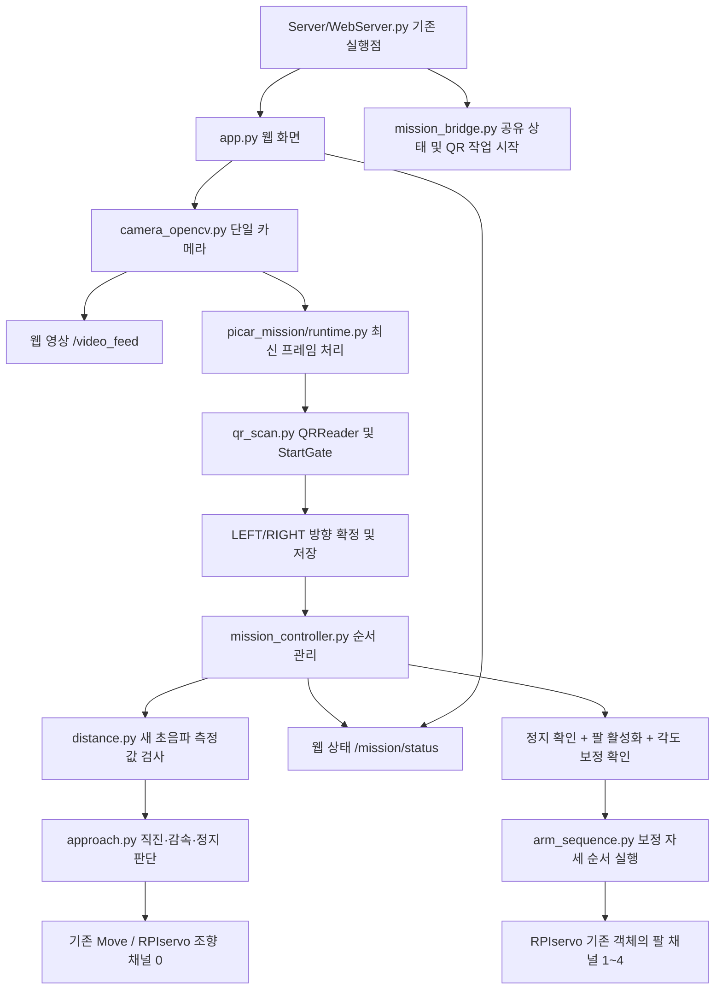

# PiCar-Pro V2 통합 프로젝트

제조사 기본 코드 전체와 QR 인식 모듈을 함께 포함합니다. **시작 파일은 기존 `Server/WebServer.py`입니다. 새 `main.py`는 없습니다.**

현재 연결된 단계는 **QR 인식 → 방향 저장 → 직진 → 감속 → 모니터와 거리 30cm에서 정지 명령 → 정지 확인**입니다. 그 뒤 보정이 완료된 팔 설정을 활성화하면 **첫 물체 이동 → 두 번째 물체 이동 → 완료**까지 실행합니다. 거리 보정은 **0cm**입니다. **기본 설정에서는 QR을 확인하면 실제로 전진하지만, 팔은 임시 각도 상태라 자동 실행을 잠가 두었습니다.** 자동 모드에서는 기존 웹·음성·영상 추적의 움직임 명령을 차단하고 중지 명령은 받습니다.

## 모듈 연결



기존 QR 파일을 삭제하지 않고 모듈로 재사용합니다. `runtime.py`는 공식 카메라의 원본 프레임을 받아 방향을 확정하고, 별도 미션 작업이 이를 읽어 주행합니다. LEFT/RIGHT는 같은 직진 경로를 사용합니다. `first_direction`은 완료·오류·중지 후에도 유지되며 재시작하면 초기화됩니다. 주행 전에는 조향 채널 0만 중앙으로 맞춥니다. 팔 모듈은 정지 확인 후에만 채널 1~4를 사용하며 조향 채널 0을 사용하지 않습니다.

## 이미 기본 동작이 확인된 라즈베리파이에서 실행

제조사 `setup.py`로 설치된 Python/하드웨어 환경과 I2C/SPI 설정을 전제로 합니다. 실행은 라즈베리파이에서 합니다.

```bash
git clone https://github.com/goldpiggg/picar.git
cd picar
# 기존 자동 실행 서버와 카메라/포트를 동시에 차지하지 않도록 중지
sudo systemctl stop Adeept_Robot.service
sudo python3 Server/WebServer.py
```

브라우저에서 로봇 IP의 다음 주소를 엽니다.

- `http://로봇IP:5000/`: 원래 웹 제어 화면
- `http://로봇IP:5000/mission`: 영상과 QR 상태
- `http://로봇IP:5000/mission/status`: 모듈 연결 상태 JSON

카메라 앞에 LEFT 또는 RIGHT를 보여주면 다음 단계를 자동으로 수행합니다. PICK/PLACE만으로는 출발하지 않습니다.

```text
WAIT_QR → CHECK_DISTANCE → APPROACH → SLOW_APPROACH → VERIFY_STOP → STOPPED_WAIT
```

QR은 같은 방향을 연속 2프레임 이상, 최소 0.15초 확인하면 확정합니다. 느린 영상 처리에 맞춰 관측 간격과 프레임 나이를 각각 1.5초까지 허용합니다. 방향 확정 이후에는 카메라 영상이 끊겨도 저장한 방향과 초음파로 동작을 이어갑니다. 이 미션은 영상으로 팔을 추적하는 방식이 아닙니다.

`CHECK_DISTANCE`에서 새 초음파 값 3개와 조향 안정 대기를 확인한 뒤 출발합니다. 출발 전 측정 실패는 최대 5초 동안 다시 기다리며, `/mission/status`의 `distance_wait_reason`과 `distance_samples`로 기다리는 이유를 확인할 수 있습니다. 실패 뒤에는 유효한 새 측정값 3개를 다시 모읍니다. 끝내 확보하지 못하면 출발하지 않고 오류로 종료합니다. 주행 중 측정 실패·0.25초 초과의 오래된 값은 계속 즉시 정지 처리합니다.

50cm 안쪽에서 PWM 명령을 점차 줄이고, 원시 거리 또는 중앙값이 30cm 이하가 되면 정지 명령을 내립니다. 새 측정값 4개로 만든 창이 0.6cm 이내로 안정되고 30±1cm 범위에 있는 상태가 0.6초 이상 지속되어야 정지가 확인됩니다. 이때 `command_speed=0`, `approach_complete=true`가 되고 저장한 방향을 유지합니다. 기본 임시 팔 설정에서는 `STOPPED_WAIT`에서 대기합니다. 팔 활성화와 각도 보정 확인을 모두 마친 경우에만 `ARM_TRANSFER → COMPLETE`로 이어집니다. 자동 재출발·후진 위치 보정은 하지 않습니다.

모터가 정지 명령 이후 굴러간 거리까지 보정하는 제동거리 모델은 아직 적용하지 않았습니다. 따라서 목표 30cm와 실제 정지거리가 같다고 보장하지 않습니다. 기준 범위를 넘거나 정지가 확인되지 않으면 성공으로 표시하지 않고 `ERROR` 상태로 멈춥니다. 거리 안정 검사는 초음파 기준의 정지 추정이며 바퀴 엔코더로 실제 정지를 확인하는 방식은 아닙니다.

`/mission`의 **전체 동작 중지** 버튼과 명시적인 `stop` 명령은 QR 대기 중에도 미션을 취소합니다. QR 대기 중에는 차단된 화살표·팔 버튼을 놓을 때 생기는 `DS/TS/LRstop/armstop/HAstop`만으로 미래의 미션을 취소하지 않습니다. QR 확정 후에는 이 버튼 해제 명령도 계속 정지·취소로 처리합니다. 오류·중지·완료 후 자동으로 다시 출발하지 않으며 새 도전은 서버를 재시작합니다. 웹 연결이 끊겨도 QR 확인 후의 자동 주행은 로봇 내부에서 계속됩니다. 중지 화면에 접근할 수 없으면 로봇 전원을 직접 차단하세요.

**실행 시 제조사 코드가 서보 초기 위치 이동을 수행하며, QR 확인 후에는 주행합니다.** 최초 점검은 바퀴를 띄운 상태에서 모터·조향 방향과 중지 처리를 확인하고, 이후 낮은 속도로 넓은 공간에서 시험하세요. 기존 서버를 종료하지 않고 두 번째 서버를 띄우지 마세요. 사용 중인 포트는 하드웨어 import 전에 검사합니다. 이 저장소를 받는 것만으로 현재 자동 실행 중인 예전 설치본이 교체되지는 않습니다.

## 이 통합본을 부팅 시 자동 실행하도록 등록

위 수동 실행을 Ctrl+C로 종료하고, 저장소 루트에서 다음 명령을 한 번 실행합니다.

```bash
sudo python3 scripts/register_service.py --start
```

이는 기존 `Adeept_Robot.service`를 이 저장소의 `Server/WebServer.py`로 연결합니다. 기존 서비스 파일은 최초 한 번 `.before-picar` 파일로 보관합니다. Python 라이브러리 재설치나 재부팅은 하지 않습니다. `--start`를 빼면 등록 후 정지 상태로 둡니다. 이 스크립트는 현재 PC에서 실행할 필요가 없습니다.

```bash
sudo systemctl status Adeept_Robot.service --no-pager
sudo journalctl -u Adeept_Robot.service -n 60 --no-pager
```

완전히 새 SD 카드라면 제조사 설치 절차(`setup.py`, I2C/SPI 등)를 먼저 수행해야 합니다. 제조사 설치 스크립트는 시스템 패키지 설치와 재부팅을 포함하므로, 기존 환경에서 QR 추가만을 위해 다시 실행하지 않습니다.

## 설정

저장소 루트의 `mission_config.json` 한 곳에서 설정합니다. 파일을 바꾼 뒤 서버를 재시작합니다.

| 항목 | 기본값 | 의미 |
|---|---|---|
| `target_distance_cm` | 30.0 | 모니터와 초음파 센서 사이 목표 거리 |
| `distance_offset_cm` | 0.0 | 원시 거리값에 더하는 보정값 |
| `auto_approach_enabled` | true | QR 확정 후 자동 접근. false면 기존 수동 제어 및 QR 확인만 사용 |
| `arm_enabled` | false | 정지 확인 후 팔 작업 활성화. arm_poses.json 보정 확인도 필요 |
| `cruise_speed` / `slow_speed` | 30 / 18 | 제조사 모터 API의 PWM 명령(0~100). cm/s가 아님 |
| `slow_distance_cm` | 50.0 | 감속 구간 시작 거리 |
| `distance_max_age_seconds` | 0.25 | 초음파 측정 시각 기준 최대 나이 |
| `distance_filter_size` | 3 | 서로 다른 새 측정값으로 구성한 중앙값 창 |
| `sensor_warmup_seconds` | 5.0 | 출발 전 유효한 초음파 값을 다시 기다리는 최대 시간 |
| `approach_timeout_seconds` | 40.0 | 주행 단계 최대 시간 |
| `progress_timeout_seconds` / `progress_min_cm` | 5.0 / 0.3 | 이 시간 동안 이 거리 이상 가까워지지 않으면 중지 |
| `stop_tolerance_cm` | 1.0 | 정지 성공 확인 범위의 반폭 |
| `stop_hold_seconds` / `stop_samples` | 0.6 / 4 | 새 측정값 창의 안정 상태 유지 시간 / 최소 개수 |
| `qr_enabled` | true | 기존 서버와 함께 QR 모듈 실행 |
| `camera_backend` | usb | 수업 자료의 USB 웹캠. 리본 케이블 카메라는 csi |
| `camera_source` | 0 | OpenCV 카메라 인덱스 또는 장치 경로 |
| `required_frames` | 2 | 최소 연속 인식 프레임 수 |
| `hold_seconds` | 0.15 | 같은 방향을 확인하는 최소 시간 |
| `max_gap_seconds` | 1.5 | 연속 인식 사이 허용 간격 |
| `max_frame_age_seconds` | 1.5 | 처리할 카메라 프레임의 최대 나이 |

카메라는 한 번만 엽니다. QR 처리 대기열은 최신 프레임 하나만 유지합니다. 큐의 프레임 나이는 앱이 캡처 API에서 받은 시각 기준으로, 드라이버 내부 버퍼나 센서의 실제 노출 시각까지 보장하지는 않습니다. 실물 조명·초점·QR 크기와 카메라 장치 번호는 별도 확인이 필요합니다.

초음파는 gpiozero의 실제 `_read()` 획득 지점에서 측정 번호와 시각을 기록합니다. 같은 `distance` 속성을 다시 읽은 것을 새 관측으로 세지 않습니다. 기본 내부 큐를 1개로 줄이고 사용자 모듈에서 3개 중앙값 처리를 합니다. gpiozero 2.x의 `_read()` 인터페이스를 전제로 하며 [확인한 공식 소스](https://github.com/gpiozero/gpiozero/blob/v2.0.1/gpiozero/input_devices.py)에 근거합니다. 출발 전에는 위의 5초 대기 안에서 재측정하고, 주행 중 측정 실패·오래된 값·비정상적인 거리 변화·주행 정체·시간초과는 정지 후 오류로 유지합니다. QR 확정 전 카메라 오류도 출발을 막습니다. 센서가 같은 잘못된 값을 계속 새로 반환하는 고장은 단일 초음파만으로 확실히 구분할 수 없습니다.

## 폴더

```text
Server/                  제조사 웹 제어·모터·서보·초음파 및 웹 화면 파일
  WebServer.py           기존 실행점 + QR worker 시작
  mission_bridge.py      카메라/웹/QR 공용 연결
picar_mission/
  qr_scan.py             기존 QR 인식 코드, 독립 테스트 실행도 유지
  runtime.py             프레임 처리와 첫 방향 상태
  mission_controller.py  QR부터 정지 확인까지의 상태 관리
  distance.py            새 측정값·유효성·중앙값 처리
  approach.py            감속과 30cm 정지 명령 정책
  arm_sequence.py        자세 계획·속도 제한·집기/놓기 순서
  config.py              공통 설정 로드
  status.html            QR 상태 화면
  test_qr_scan.py         기존 테스트
Client/                  제조사 클라이언트 전체
Examples/                제조사 예제 전체
tests/                   통합 테스트와 실제 QR 이미지
scripts/register_service.py  기존 서비스 실행 경로 등록 도구
mission_config.json      기본 30cm, 보정 0 및 카메라 설정
arm_poses.json           임시 팔 자세·집게 각도·속도·보정 확인
docs/ARM_CALIBRATION.md  임시값 전체 표와 실제 측정·기록 방법
docs/ADEEPT_README.md     제조사 원본 README
docs/UPSTREAM.md          원본 버전과 수정 목록
```

## 로봇팔 각도 보정

[보정 안내](docs/ARM_CALIBRATION.md)에 임시값 전체와 측정 순서를 기록했습니다. `arm_poses.json`의 각도는 모두 예시이며 실제 로봇에서 검증한 값이 아닙니다. `calibration_confirmed=false`와 `arm_enabled=false`로 팔 자동 실행을 막았습니다. 이 상태에서도 기존 자동 주행은 유지됩니다.

팔은 지정 방향에서 집고 반대편 빈 상자에 놓은 뒤, 남은 반대편 물체를 처음 방향의 빈 상자에 놓습니다. 각 이동은 위쪽 접근 → 내려가기 → 집게 조작 → 들어 올리기 → 중앙 경유 → 놓기 → 후퇴 순서입니다. 관절 목표값은 20도/초 이하로 조금씩 변경합니다. 중지 시에는 팔을 처음 위치로 돌리거나 집게를 열지 않고 마지막 명령 자세를 유지합니다.

수동 자세 보정 시 `auto_approach_enabled=false`, `arm_enabled=false`로 설정하고 서버를 재시작합니다. 기존 웹 팔 조작으로 자세를 맞춘 뒤 `/mission/status`의 `commanded_servo_angles_deg`를 기록합니다. 이 값은 실제 각도 센서의 피드백이 아니라 마지막 명령 각도입니다. 실제로 물체를 잘 잡는지와 자세 사이 경로에 충돌이 없는지도 확인해야 합니다.

하드웨어 동작 없이 LEFT/RIGHT 순서와 임시 각도를 확인할 수 있습니다.

```bash
python3 -m picar_mission.arm_sequence --plan LEFT
python3 -m picar_mission.arm_sequence --plan RIGHT
```

고정 자세 방식이며 PICK/PLACE QR에 맞춰 팔을 자동 정렬하는 기능과 물체를 실제로 잡았는지 감지하는 기능은 없습니다. `COMPLETE`는 두 번의 집기/놓기 명령 시퀀스를 마쳤다는 뜻입니다. 초음파 센서가 팔과 함께 회전할 수 있으므로 팔 작업 중에는 정면 30cm 거리 검사를 다시 적용하지 않고 바퀴 제어 잠금을 유지합니다.

## 검증

테스트 환경에는 NumPy와 OpenCV가 필요합니다. 테스트는 모터·서보 하드웨어를 초기화하지 않습니다.

```bash
python3 -m unittest discover -s picar_mission -p 'test_*.py' -v
python3 -m unittest discover -s tests -p 'test_*.py' -v
```

원본 QR 이미지 인식, 방향 충돌·누락, 실제 QR worker의 방향 저장, 카메라 클래스의 프레임 전달·장치 반환, 오래된 프레임 거부, 설정 검증을 포함합니다. 카메라 클래스는 제조사 모듈의 하드웨어 초기화 부분을 제외하고 실제 메서드와 가상 장치로 테스트합니다. 실제 Raspberry Pi/I2C/PWM/CSI/웹 서버 전체 구동은 이 PC에서 검증하지 않았습니다.

자동 접근 테스트는 LEFT/RIGHT 동일 주행, 감속, 정지 후 대기, 원시 거리 우선 정지, 새 echo 구별, 센서/카메라 오류, 정체, 취소, 정지선 초과, 수동 명령 차단을 포함합니다. 모터 명령에 따라 거리와 속도가 변하는 가상 차량 모델 3종에서도 정지까지 시험합니다. 이 모델의 PWM-속도 대응과 감속도는 가정이므로 실제 성능 수치로 해석하지 않습니다. 실제 배터리·바닥·탑재 상태에서 PWM과 정지 오차를 측정해야 합니다.

## 출처와 범위

[Adeept 공식 저장소](https://github.com/adeept/Adeept_PiCar-Pro)의 커밋 `7703206c5e9e345c772232c0686e381790b87bb0`을 기준으로 코드 전체를 가져왔습니다. 기존 사용자 커밋은 유지합니다. 제조사 예제와 과거 이력에 API 키가 포함돼 있어 제조사 과거 Git 이력은 가져오지 않고, 해당 예제는 키를 환경변수에서 읽도록 수정했습니다. 원본의 저작권 표기와 웹 리소스를 보존했으며 이 프로젝트가 제조사 코드의 라이선스를 새로 부여하지 않습니다. 변경 목록은 [UPSTREAM 기록](docs/UPSTREAM.md)에 있습니다.

---

## 제조사 원본 소개
Adeept PiCar-Pro is an open source intelligent robotics product for artificial intelligence, robotics enthusiasts and students. This product is based on the Raspberry Pi motherboard using the python language and is compatible with the following Raspberry Pi models: 3B,3B+,4,5, etc.


## Resources Links

[RobotName]: Adeept PiCar-Pro \
[Item Code]: ADR019 \
[Official Raspberry Pi website]: https://www.raspberrypi.org/downloads/    \
[Official website]:  https://www.adeept.com/        


## Getting Support or Providing Advice

Adeept provides free and responsive product and technical support, including but not limited to:   
* Product quality issues 
* Product use and build issues
* Questions regarding the technology employed in our products for learning and education
* Your input and opinions are always welcome

We also encourage your ideas and suggestions for new products and product improvements
For any of the above, you may send us an email to:     \
Technical support: support@adeept.com      \
Customer Service: service@adeept.com


## About Adeept

Adeept was founded in 2015 and is a company dedicated to open source hardware and STEM education services. The Adeept technical team continuously develops new technologies, uses excellent products as technology and service carriers, and provides comprehensive tutorials and after-sales technical support to help users combine learning with entertainment. The main products include various learning kits and robots for Arduino, Raspberry Pi, ESP32 and BBC micro:bit.    \
Adeept is committed to assist customers in their education of robotics, programming and electronic circuits so that they may transform their creative ideas into prototypes and new and innovative products. To this end, our services include but are not limited to:   
* Educational and Entertaining Project Kits for Robots, Smart Cars and Drones
* Educational Kits to Learn Robotic Software Systems for Arduino, Raspberry Pi and micro: bit
* Electronic Component Assortments, Electronic Modules and Specialized Tools
* Product Development and Customization Services


## Copyright

Adeept brand and logo are copyright of Shenzhen Adeept Technology Co., Ltd. and cannot be used without written permission.
